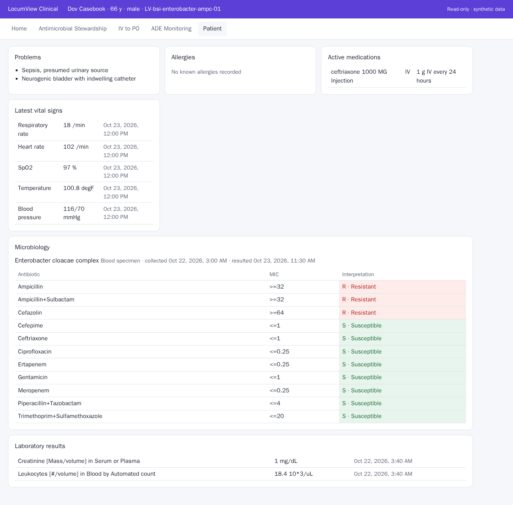

# Phase 9 lite M3, step 1: SMART EHR launch of the clinical app, end to end, locally

Run 2026-10-25 on operator workstation node1 by Claude Code, for owner review. Plan M3 step 1 (no cluster, desktop or
image change). Synthetic data only.

**Result: passes.** In a real browser (Playwright's Chromium), a clinician signs in to the local OpenEMR 8.4.1, opens a
scenario patient's chart, launches the app from the chart's "SMART Enabled Apps" card, approves OpenEMR's consent
screen, and the app opens in OpenEMR's dialog on that patient with their chart and microbiology. One command,
`clinical/app/e2e.sh`, from a fresh instance to teardown in about 2 minutes 20 seconds; passed for
`LV-bsi-enterobacter-ampc-01` (blood, Enterobacter cloacae complex) and `LV-uti-esbl-mismatch-01` (urine, E. coli).

(Times are UTC: the test browser runs in UTC. On the desktop, Chrome shows local time.)

## Design, and why it changed during the step

The approved plan had the React app talk to OpenEMR directly as a public SMART client. Three OpenEMR 8.4.1 defects
ruled that out (`docs/upstream/openemr-8.4.1.md`, items 1 to 4): its FHIR API does not answer CORS preflight requests;
it registers browser apps only for the patient (portal) role, and user scopes only for confidential clients; and its
user-to-patient check for a launched patient always fails. The owner chose a backend for the app (option A):

- **Gateway** (`clinical/app/server/gateway.py`, FastAPI): completes the SMART EHR launch on the server (state, PKCE
  S256, client secret), accepts a launch only from the configured EHR, keeps tokens server-side, gives the browser an
  HttpOnly, Secure, SameSite=Lax session cookie, forwards GET requests for eight resource types, and pins every
  request to the launched patient (a clinician-scoped token could otherwise read any patient). It serves the built
  app from the same origin and allows only the EHR to frame it.
- **App** (`clinical/app/`, React, TypeScript, Vite): calls the gateway only.
- **OpenEMR patch** (`clinical/spike/patches/0001-smart-launch-patient-access.diff`, two lines): fixes items 1 and 2,
  without which no EHR launch with patient context works. Applied to each fresh local instance by
  `clinical/spike/run.sh up`. To be offered upstream.

OpenEMR opens SMART apps in a full-height modal dialog with an iframe inside its own window, so on the desktop the app
appears over the chart in the managed Chrome. The gateway and OpenEMR share the registrable domain, so the session
cookie is same-site in that iframe.

## Checks

| Check | Result |
|---|---|
| App data layer (Vitest), against the M1 OpenEMR output | 8 of 8 pass: organism text, MIC qualifiers, susceptibilities joined by specimen accession |
| Gateway (unittest, fake EHR) | 10 of 10 pass: launch only from the configured EHR; PKCE verifier matches challenge; forged or reused state refused; cookie HttpOnly, Secure, SameSite=Lax and no token in any response; no session, no data; patient pinned; GET only; allowed types only; pages followed; security headers |
| Live gateway | no session 401; foreign iss 400; CSP `frame-ancestors` the EHR only |
| End to end | passes for two patients; granted scopes exactly the gateway's read-only user scopes |
| Supply chain | npm packages and Python wheels released before 2026-10-11; Python requirements hash-pinned (`--require-hashes`); 0 npm audit findings; Node 22, Python 3.13 and Playwright images pinned by digest |

## Limits

Local only: OpenEMR, the gateway and the app on node1's localhost, with a throwaway TLS certificate and
`EHR_TLS_VERIFY=false` for the instance's self-signed certificate. The test opens the chart page on its own rather than
inside OpenEMR's tabbed main window, where the dialog is laid out; there the dialog is not shown, so the test sets the
sign-in fields and clicks OpenEMR's buttons through the page (driving the main window is a known improvement). The
gateway's sessions live in memory (one replica). No Keycloak sign-in yet (M3 step 4), no desktop launcher or Chrome
allowlist (step 5), no rules or findings (M4). Not clinical validation.

During diagnosis a debug dump printed the local instance's per-run administrator password (random, localhost only,
used nowhere else). The instance was destroyed at once and rebuilt with new credentials; debug output now reports
fields only as filled or empty.
